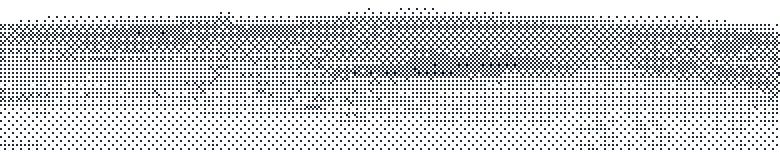

<!-- Art: Michelangelo, The Creation of Adam (public domain). NASA photo STS-41B, Bruce McCandless II (public domain). -->

  <picture>
    <source media="(prefers-color-scheme: dark)" srcset="assets/hero-dark.png"/>
    
  </picture>

<h1 align="center">Hi 👋, I'm Jaehun</h1>

<h3 align="center">Product Engineer</h3>

<samp>Make it feel obvious.</samp>

I build AI products people understand, trust, and enjoy using.

<h2 align="center"><samp>about</samp></h2>

<picture>
  <source media="(prefers-color-scheme: dark)" srcset="assets/astronaut-dark.png"/>
  
</picture>

People rarely remember the model or the stack. They remember a moment: the screen that knew what they meant, the wait that never felt long, the answer they could trust.

I care about those moments. I shape the flow, the motion, and the words until a product feels obvious, then build it end to end.

AI is my favorite material because it is powerful and unpredictable. My job is to make it feel calm: clear about what it knows, honest about what it doesn't, and always pointing to what to do next.

I build with **Codex** and **Claude**.

 

<h2 align="center"><samp>tools</samp></h2>

  
   
  &nbsp;
  &nbsp;
  

<h2 align="center"><samp>say hi</samp></h2>

  &nbsp;
  &nbsp;
  

  <picture>
    <source media="(prefers-color-scheme: dark)" srcset="assets/horizon-dark.png"/>
    
  </picture>

