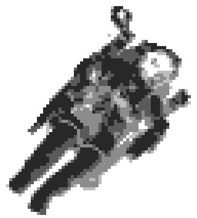
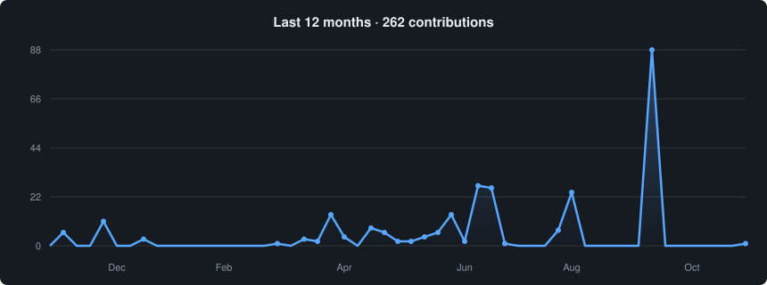

<!-- Hero: Michelangelo, The Creation of Adam (public domain). About: NASA photo STS-41B, Bruce McCandless II (public domain). -->

  <picture>
    <source media="(prefers-color-scheme: dark)" srcset="assets/hero-dark.png"/>
    
  </picture>

<h1 align="center">안녕하세요 👋, JUNG JAEHUN입니다</h1>

<h3 align="center">Product Engineer</h3>

<samp>Define clearly · Engineer reliably · Ship thoughtfully</samp>

문제 정의부터 AI, 백엔드, 사용자 경험까지 하나의 제품으로 만듭니다.

<h2 align="center">🚀 About Me</h2>

<picture>
  <source media="(prefers-color-scheme: dark)" srcset="assets/astronaut-dark.png"/>
  
</picture>

모델의 예측보다, 사용자가 이해하고 믿고 행동할 수 있는 제품을 만드는 일에 집중합니다.

모호한 문제를 구조화하고, 데이터 흐름과 시스템을 설계한 뒤 직접 구현합니다.

지금까지 **[EV Fault GPT](https://github.com/deephoon/EV-fault-GPT)**(EV 이상 진단), **[V2X Safety Agent](https://github.com/deephoon/V2X_Agent)**(차량 안전 에이전트), **[고치다](https://github.com/DO-DAA/gochida)**(AI 생활시공 요청), **[Tomato](https://github.com/deephoon/Tomato)**(집중 관리)를 만들었습니다.

개발에는 **Codex**와 **Claude**를 씁니다.

 

<h2 align="center">🤝 Connect</h2>

  &nbsp;
  &nbsp;
  

<h2 align="center">💻 Tech Stack</h2>

  
   
  
   
  &nbsp;
  

<h2 align="center">📊 GitHub Stats</h2>

  

<h2 align="center">📈 Activity Graph</h2>

  

